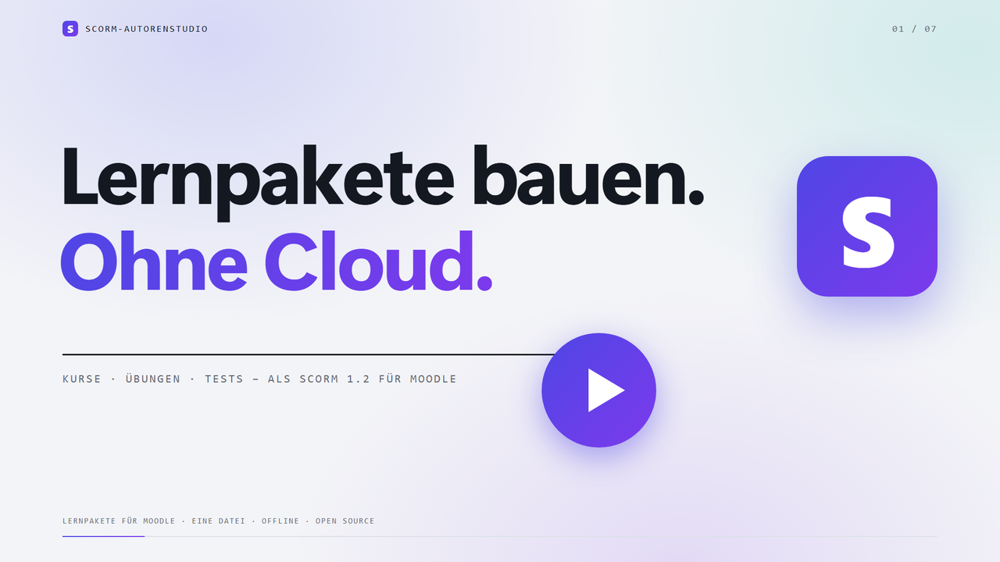
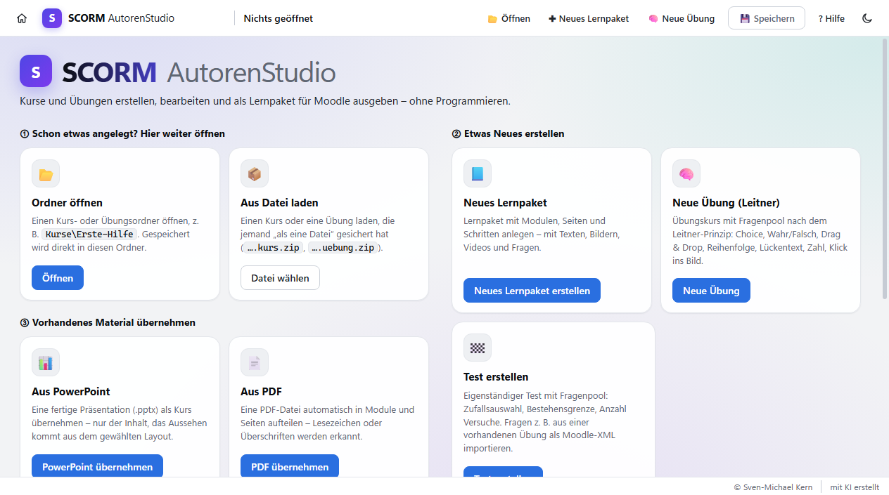
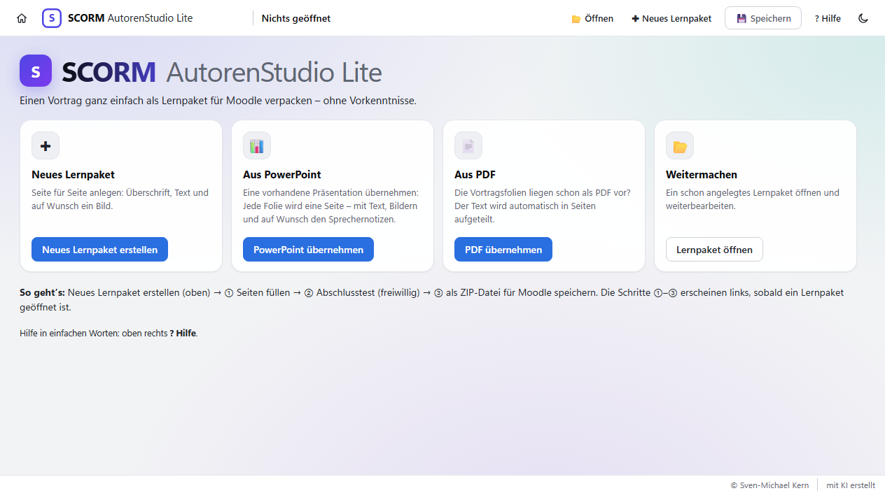

# SCORM-AutorenStudio

**Kurse und Übungen für Moodle erstellen – ohne Programmieren, ohne Installation und ohne Internetverbindung** (Ausnahme: eingebettete YouTube-Videos, siehe [Datenschutz](#datenschutz)).

Das SCORM-AutorenStudio ist ein Autorenwerkzeug in einer einzigen HTML-Datei. Ein Doppelklick genügt: Es läuft im Browser (Google Chrome oder Microsoft Edge) direkt von deinem Rechner und erzeugt Lernpakete im Format SCORM 1.2, die du in Moodle hochlädst.

## Vorstellung in 48 Sekunden

*Bild anklicken, um das Video abzuspielen (MP4, 48 Sekunden, mit Musik).*

> **In English:** SCORM-AutorenStudio is a free, open-source authoring tool for e-learning courses. It is a single HTML file that runs offline in Chrome or Edge and builds SCORM 1.2 packages for Moodle. The user interface and the manual are in German.

Aktuelle Version: **3.48.7**

## Loslegen

1. Das Projekt herunterladen: auf dieser Seite oben den grünen Knopf **Code** anklicken, dann **Download ZIP**. Die ZIP-Datei entpacken.
2. `SCORM-AutorenStudio.html` doppelklicken. Die Datei öffnet sich in Chrome oder Edge.
3. Die Anleitung steht im Programm: oben rechts **? Hilfe** oder Taste F1.

Es wird nichts installiert. Die eine Datei enthält alles – auch die Layouts, die Anleitung und alles, was ein Lernpaket braucht.

### Nur einen Vortrag als Lernpaket verpacken?

Dafür gibt es die vereinfachte Ausgabe `SCORM-AutorenStudio-Lite.html` mit drei Schritten: Seiten (Text und Bild, auch aus PowerPoint oder PDF) → Abschlusstest (freiwillig) → für Moodle speichern. Ein Lernpaket aus der Lite-Ausgabe lässt sich später im großen Studio weiterbearbeiten.

## Was es kann

- **Kurse** mit Modulen, Seiten und Schritten: Texte, Bilder, Videos, Ton
- **17 Fragearten**, auf Wunsch als Pflichtfrage
- **Interaktive Bausteine:** Reiter, Klappkarten, Bild mit Info-Punkten, Ablauf, Galerie, Vorher/Nachher, Glossar, Fallszenario, Software-Simulation, Freie Folie mit Folienbibliothek
- **Abschlusstest** mit Bestehensgrenze und Teilnahmebestätigung
- **Übungen** nach dem Leitner-Prinzip (Karteikasten)
- **Übernahme** aus PowerPoint, PDF und vorhandenen SCORM-Paketen
- **Layouts** zum Austauschen, eigene Layouts per Assistent
- **Punkte und Abzeichen**
- **Werkzeuge:** Prüfung, Medien, Suchen & Ersetzen, Druckansicht, Sicherungen
- **Lernpakete** (SCORM 1.2) für Moodle – auch für Handy und Tablet

## Was du brauchst

- einen Rechner mit **Google Chrome** oder **Microsoft Edge** in aktueller Fassung
- für die fertigen Lernpakete: **Moodle**. Dafür sind die Lernpakete gemacht; andere Lernplattformen mit SCORM 1.2 wurden nicht erprobt.

## Datenschutz

Das Programm läuft nur auf deinem Rechner. Es lädt nichts aus dem Internet nach und sendet keine Daten – keine Statistik, keine Anmeldung, keine Schriften oder Bibliotheken von fremden Servern. Es greift nur auf den Ordner zu, den du ausdrücklich freigibst.

**Einzige Ausnahme: YouTube.** Bettest du über den Knopf **▶ YouTube** ein Video ein, verbindet sich der Browser beim Abspielen mit YouTube (Google) – im Studio und im fertigen Lernpaket. Das Studio nutzt dafür die datensparsame Adresse `youtube-nocookie.com`. Ohne YouTube-Video entsteht keine Verbindung ins Internet.

Mehr dazu im Programm unter **? Hilfe → Sicherheit**.

## Freie Software (Open Source)

Copyright (c) 2026 Sven-Michael Kern · lizenziert unter der **EUPL, Version 1.2 oder neuer** (Open-Source-Lizenz für die Europäische Union).

- Du darfst das Programm kostenlos nutzen, weitergeben und verändern.
- Wer es – auch verändert – weitergibt, gibt Lizenz und Quelltext mit. So bleibt es für alle frei.
- **Lernpakete, die du mit dem Programm erstellst, gehören dir.** Für sie gelten keine Lizenzpflichten (siehe `LIZENZ-HINWEISE.txt`, Abschnitt 2).
- Das Programm wird ohne Gewährleistung bereitgestellt.

Der Lizenztext liegt in zwei amtlichen, gleichwertigen Sprachfassungen bei: [`LIZENZ.txt`](LIZENZ.txt) (Deutsch) und [`LICENSE`](LICENSE) (Englisch). Urheber, enthaltene fremde Software und weitere Hinweise stehen in [`LIZENZ-HINWEISE.txt`](LIZENZ-HINWEISE.txt).

## Quelltext

`SCORM-AutorenStudio.html` ist zugleich Programm und lesbarer Quelltext: HTML, CSS und JavaScript in einer Datei, durchgehend erklärt. Die eingebetteten Bausteine – Layouts, Kurs-Player, Leitner-Test, Fragen-Engine, Anleitungen – liegen lesbar im Ordner [`Quellen`](Quellen), zusammen mit dem Werkzeug, das sie einsetzt (`Quellen\werkzeuge\bauen.ps1`, Windows PowerShell). Wie alles zusammenhängt, erklärt [`Quellen/LIESMICH.txt`](Quellen/LIESMICH.txt).

## Mitmachen

Fehler gefunden oder eine Idee? Gern als *Issue* melden. Änderungsvorschläge (*Pull Requests*) sind willkommen. Dieses Projekt wird bei jeder neuen Version als Ganzes aus dem Entwicklungsstand des Urhebers erzeugt; übernommene Vorschläge erscheinen deshalb mit der nächsten Version. Beiträge stehen unter derselben Lizenz.

## Hinweis zur Entstehung (künstliche Intelligenz)

Dieses Programm wurde von Sven-Michael Kern mit Unterstützung künstlicher Intelligenz (Claude, Anthropic) entwickelt. Das Programm selbst enthält keine künstliche Intelligenz und nutzt keine KI-Dienste.
